# LawVerify 系统架构、数据流向与运行时

本文基于当前仓库源码（`app/`、`server/`、`cloud-server/`、`web/`）梳理，描述到模块与文件粒度。
凡源码中无法确证的内容，均标注「未验证」。

---

## 1. 系统边界

LawVerify 由四块可独立运行的代码组成，外加若干外部依赖：

| 目录 | 角色 | 运行时 |
| --- | --- | --- |
| `app/` | 桌面客户端（Electron 主进程 + React 工作台） | Electron 44 / Node 内置 |
| `server/` | 业务后端（案件、证据、文书、联动、本地工作区） | Node 22+ / Express 5 / TS ESM |
| `cloud-server/` | 云端账户平台（身份、积分、订单、发票、发行、AI 网关） | Node / Express 5 / PostgreSQL |
| `web/` | 官网 + 账户中心前端与其静态服务 | React / Node http |

设计上是「模块化单体 + 独立云端平台」：桌面端自带完整业务能力，云端只承担账号、计费与模型网关，
不依赖云端也能进行本地案件工作（`AI_GATEWAY_MODE=direct` 直连模型供应商时）。

---

## 2. 总体架构图

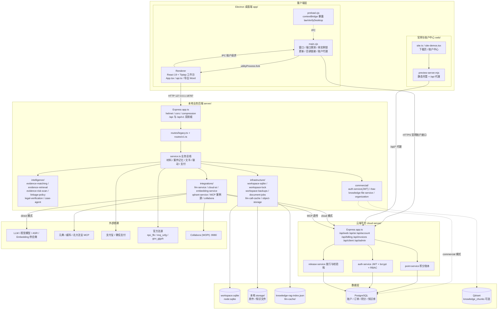

关键边界说明：

- `server/` 是**唯一的案件真相源**。案件、证据、文书、联动结果全部落在本地工作区，
  云端不存案件内容，只存账号、积分与调用流水。
- `cloud-server` 的 `/api/ai` 是**模型网关**：桌面端配置 `AI_GATEWAY_MODE=cloud` 时，
  所有 LLM / Embedding / ASR 调用经此转发并按积分计费；配置为 `direct` 时桌面端直连供应商。
- `web/` 是官网与账户中心前端，`preview-server.mjs` 只做静态托管 + `/api/*` 反向代理，
  自身不含业务逻辑。

---

## 3. 运行时拓扑

### 3.1 桌面发布态（用户实际运行的形态）

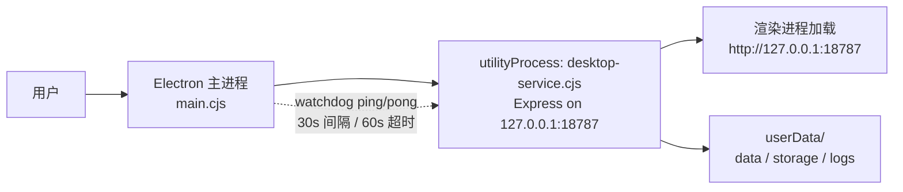

- 端口：`findAvailablePort(18787, 1)`，实际**只尝试 18787 一个端口**。
- 进程模型：主进程 `utilityProcess.fork(desktop-service.cjs)`，子进程内
  `import(.desktop/server/dist/app.js)` 并 `app.listen(127.0.0.1:PORT)`，
  同一进程同时提供 API 与前端静态资源。
- 看门狗：`service-supervisor.cjs` 30s 一次 ping、60s 无响应即 kill；
  退出后按 `[500,1500,4000,8000,15000] ms` 退避重启，5 次用尽后每 30s 低频重试，永不放弃。
- 稳定日志：`userData/logs`，事件来源包括 stdout/stderr 重定向、无响应、进程退出、内存 RSS。
- 渲染进程崩溃或窗口 8s 无响应时弹窗恢复（reload），草稿保留。
- 数据目录（`applyDesktopServerEnv`）：

| 环境变量 | 桌面端取值 |
| --- | --- |
| `APP_RUNTIME_ROOT` | `app/.desktop/server`（内置 dist + migrations + seeds） |
| `APP_DATA_ROOT` | `userData/runtime` |
| `WORKSPACE_DATA_DIR` | `userData/data` |
| `STORAGE_LOCAL_ROOT` | `userData/storage` |
| `FRONTEND_DIST_DIR` | `app/dist` |
| `AUTO_RUN_MIGRATIONS` | `false` |
| `AI_GATEWAY_MODE` | `cloud`（由 `.desktop/server/.env.local` 提供） |
| `CLOUD_API_BASE_URL` | `https://lawverify.zhijing.fun`（仅当原值是本机地址时替换） |

### 3.2 开发态

| 服务 | 端口 | 启动命令 |
| --- | --- | --- |
| 桌面前端 | 5173 | `app: npm run dev:web` |
| 本地后端 | 8787 | `server: npm run dev`（tsx watch） |
| 云端后端 | 8788 | `cloud-server: npm run dev` |
| 官网/账户中心 | 4273 | `web: npm run dev`（vite）或 `preview-server.mjs` |
| 一键联调 | — | 根目录 `dev-workbench.cmd` / `platform-dev.cmd` |

开发态下 `app/src/api.ts` 的 `API_BASE_URL` 指向 `http://<host>:8787`，
桌面壳以 `npm run dev:electron` 加载 5173。

### 3.3 平台发布态

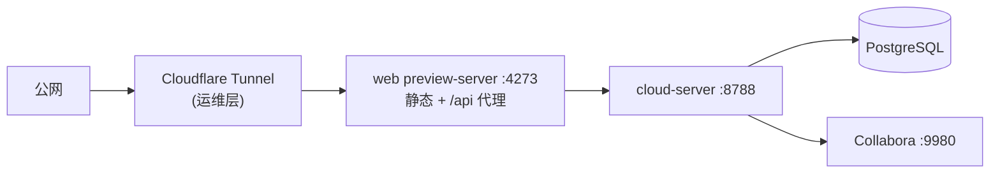

- `platform-dev.cmd` 管理 web 与 cloud-server；`install-platform-recovery.ps1`
  注册登录自启任务 `LawVerify-Platform-Autostart` 与每分钟健康检查 `LawVerify-Platform-Recovery`。
- 本地 PostgreSQL 容器端口 `54329`（`docker-compose.cloud-postgres.yml`）。
- Collabora 容器 `9980`，服务端通过 `COLLABORA_PROXY_PATH=/collabora` 反代（`integrations/collabora-proxy.ts`），
  支持 WebSocket 升级。

---

## 4. 数据流向图

### 4.1 链路 A：材料导入 → 原件理解

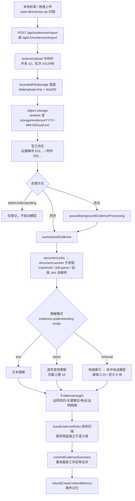

要点：

- 上传全程**按文件落盘**，内存占用与文件大小无关；单文件上限 512MB。
- 重复材料按 `contentHash` 判定：内容相同直接沿用原件理解结果并标记 `duplicateOf`。
- 摘要按 `summaryCacheKey` 缓存，内容变更即失效；`force` 可强制重跑。
- 规则化风险扫描与模型理解**互为补充**：程序瑕疵（举证期限、形式要件、签章缺失）不在语义空间内，
  检索式理解只覆盖命中块时必须靠规则兜底。

### 4.2 链路 B：案件记忆与代理立场

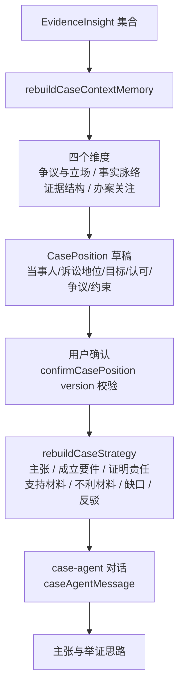

- 立场由用户显式确认后生效；系统规则明确：立场不改变客观事实，保留不利证据与矛盾。
- 策略输入用 `strategyInputKey`（记忆版本 + 立场）做缓存键；材料指纹变化时提示重新梳理。

### 4.3 链路 C：文书生成 → 句级联动 → 导出

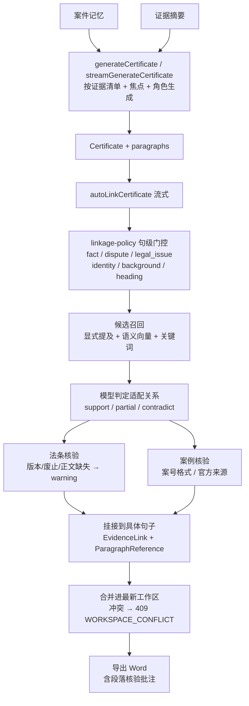

要点：

- 联动锚定到**句子**而非整段。`SentenceLinkageFocus` 记录每句的 `evidenceNeeded / statuteNeeded / caseNeeded`。
- 句级门控是**排除规则**（标题、身份字段、套话），不替代模型判断。
- 引用警示：`statute-repealed` / `statute-amended` / `statute-content-missing` 标记在引用上，
  不能当作可直接引用的依据。
- `linkageInputKey` 记录本次联动依赖的材料指纹；材料增减或重新理解后可提示重新核验。
- 保存前重读最新工作区并只合并挂接与引用，避免联动期间后台更新被旧快照覆盖。

### 4.4 链路 D：账户、积分与模型网关

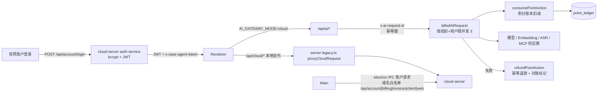

要点：

- 桌面端对云端有**三条通道**：Electron IPC 直连（发布态）、`/api/cloud/*` 本地反代（开发/浏览器态）、
  浏览器直连官网域名。
- 模型网关按「组织 + 用户」限并发 3，桌面端也按同一上限排队，避免被网关判为「分析任务过多」。
- 计费幂等键为 `ai:<requestId>`，退款键为 `ai-refund:<requestId>`；失败走退款，异常走对账。
- 案例检索有本地（内置法库 + 本地 RAG）与商业（PostgreSQL + Qdrant）两套，按
  `KNOWLEDGE_RAG_MODE=local|commercial|auto` 切换。

---

## 5. 关键流程图

本章是运行时的**过程视图**，与第 4 章的数据流向图互补：
第 4 章回答「数据往哪走」，本章回答「什么时候发生、按什么顺序发生、失败时怎么退」。

### 5.1 桌面端冷启动时序

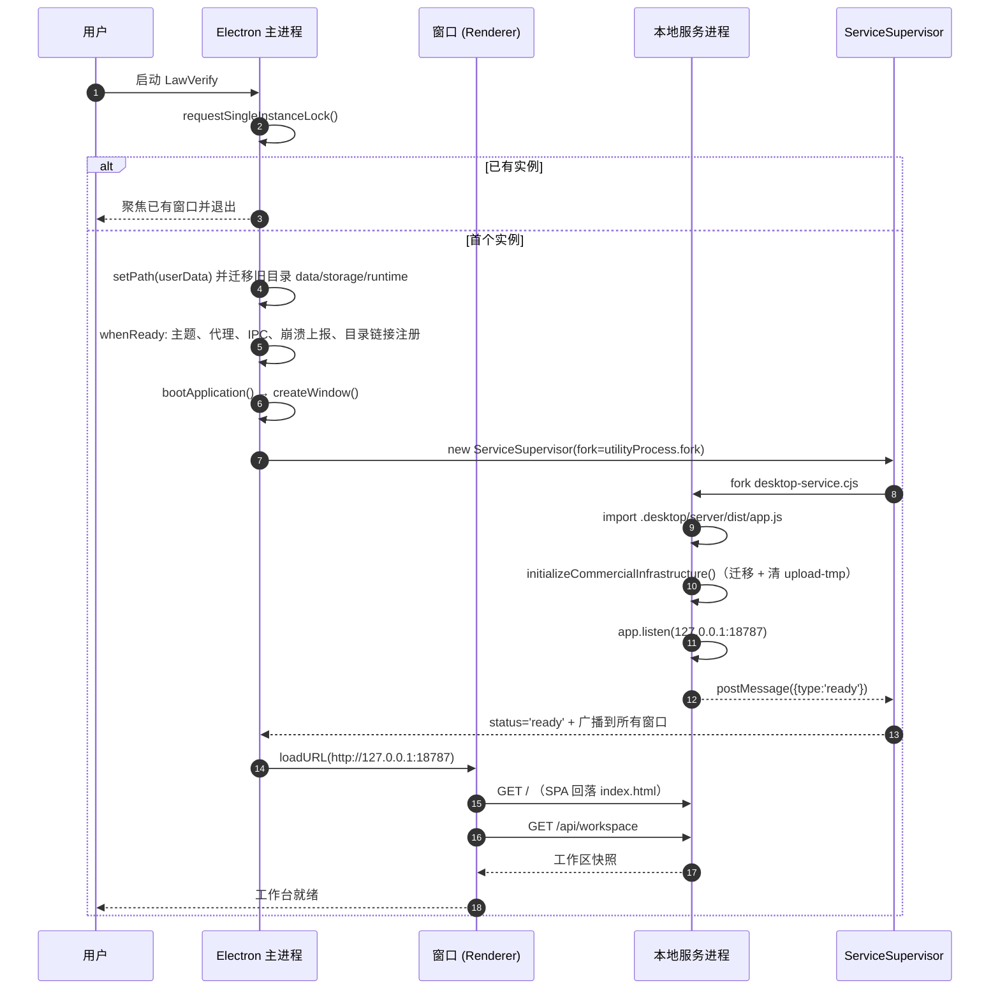

要点：

- `userData` 目录从旧的 `LexVerify` / `lexverify-mvp` **只迁移业务数据**（data / storage / runtime），
  Chromium 缓存不迁移，避免旧 UI 产物残留。
- 开发态跳过本地服务进程：窗口直接加载 `http://127.0.0.1:5173`，API 走 `http://<host>:8787`。

### 5.2 单次 API 请求的处理链

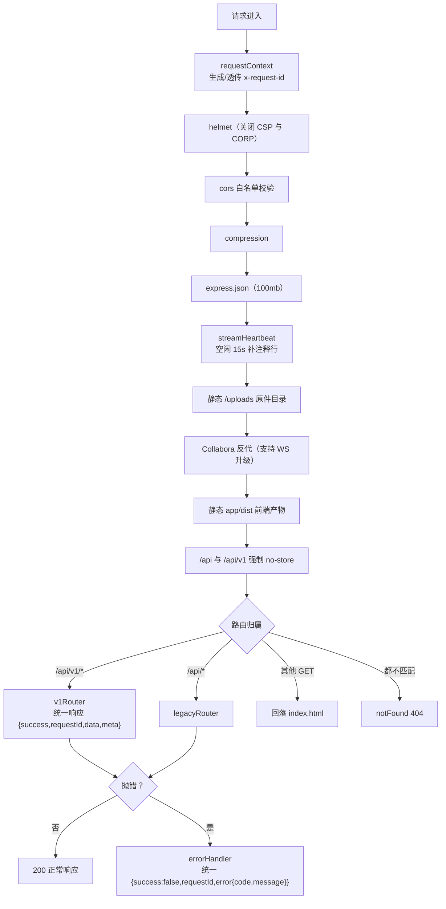

两条 API 前缀并存：`/api` 是旧接口（保持前端可运行），`/api/v1` 是版本化接口。
两者**共用同一套 service.ts 业务逻辑**，不是两套实现。

工作区账号隔离靠请求头 `x-workspace-account`（或 query 参数 `workspaceAccount`）：
路由层用 `runWithWorkspaceAccount()` 把它写进 `AsyncLocalStorage`，
`store.ts` 再据此切换到 `data/workspaces/<slug>/` 目录。

### 5.3 后台材料理解队列

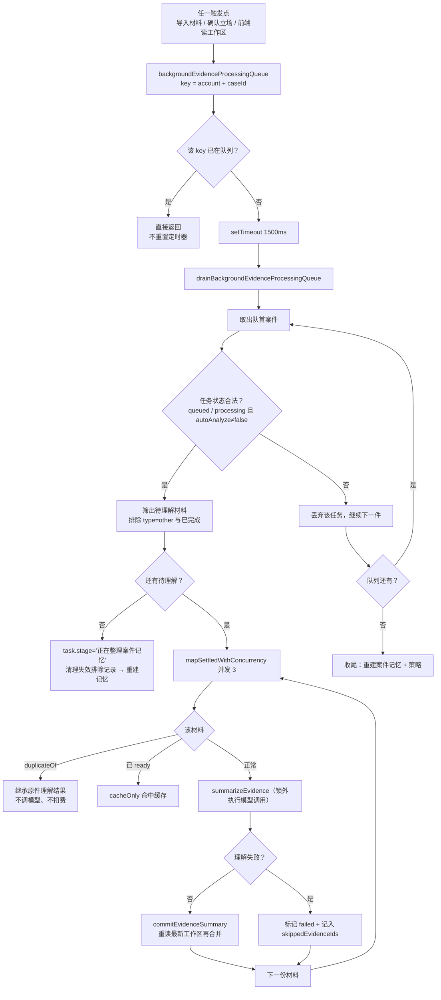

两个设计约束值得注意：

1. **队列去重**：同一案件已在队列时不重置 1500ms 定时器。
    前端每次读工作区都会重新排队，若每次都重设定时器会无限推迟，自动理解永远得不到执行。
2. **只在队首串行处理案件，案件内材料并发**：
    案件之间一次只做一个，案件内多份材料并发 3。
    理解耗时在写锁之外，落库仍由 `summarizeEvidence` 内部串行合并。

### 5.4 流式文书生成时序

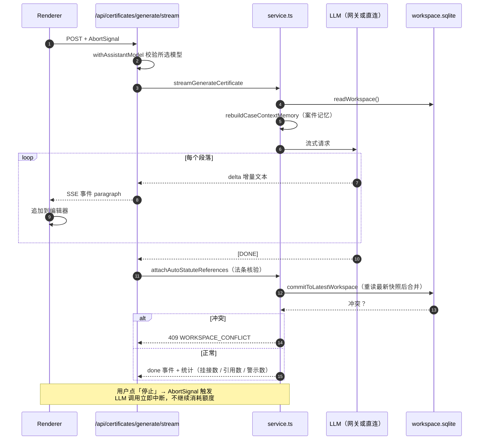

流式通道是 SSE（`text/event-stream`），服务端 `streamHeartbeat` 中间件在空闲 15s 时补一行注释，
让客户端不会把长空闲误判为断连。

### 5.5 句级联动的执行顺序

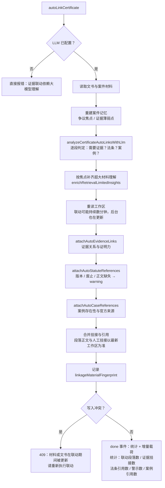

顺序上有个反直觉的点：**证据 → 法条 → 案例**是串行的三段，
每段都在上一段的结果上继续挂接，所以法条核验看到的是已经挂好证据的段落。

`done` 事件不回传全量工作区快照——那动辄十几 MB，会超过客户端流式接收上限。
改为只带增量（改写后的文书 + 本案记忆 + 本案材料理解），前端按 id 逐字段合并进本地工作区。

模型调用的结果按 `namespace + 请求内容哈希` 缓存在 `llm-cache/`，
任务被中断后重跑可以直接复用已完成的阶段（进度提示里会显示「已复用 N 项模型结果」）。

### 5.6 AI 网关计费与退款

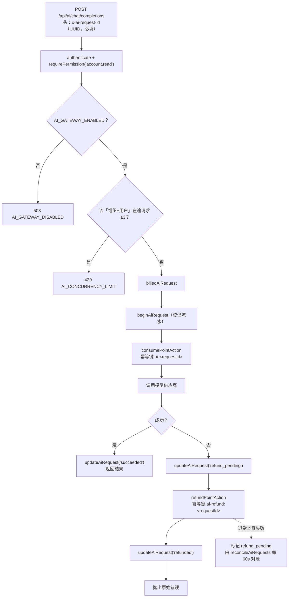

两条兜底：

- **限流发生在扣费之前**，所以 429 重试不会重复计费。
- 退款失败不吞掉，留在 `refund_pending` 状态，由云端 `reconcileAiRequests`（60s 周期）对账。

### 5.7 应用更新流程

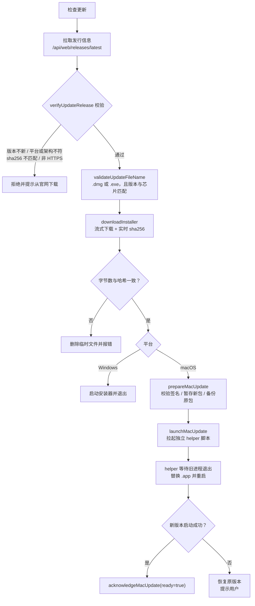

安全约束：

- 安装包必须 HTTPS，下载时实时计算 sha256 与发行信息比对。
- 文件名必须匹配当前平台与架构（`LawVerify-Mac-<ver>-<arch>.dmg` / `LawVerify-Setup-<ver>.exe`），
  防止把 mac 包装到 Windows。
- macOS 更新由独立 helper 进程完成替换，应用退出码与结果通过 `userData/updates/mac/` 下的
  状态文件回传，启动时 `readStartupJob` 校验 manifest 后才认这次更新。

### 5.8 故障自愈与降级

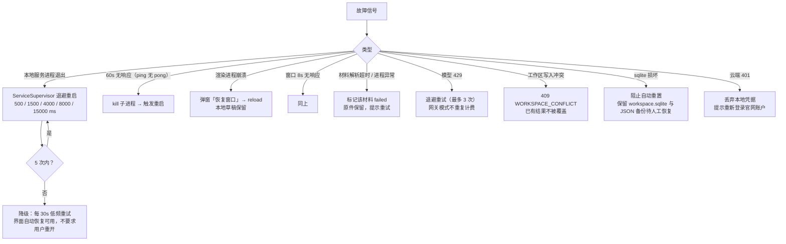

贯穿其中的原则是**「宁可降级，不丢数据」**：
本地服务起不来时低频重试而不是让用户重开应用；
sqlite 损坏时阻止自动重置而不是清库；
工作区冲突时保留已有结果而不是覆盖。

---

## 6. 持久化位置一览

| 数据 | 位置 | 形态 |
| --- | --- | --- |
| 案件、证据、文书、联动 | `userData/data/workspace.sqlite` | node:sqlite，`node:sqlite` 同步 API |
| 多账号工作区 | `userData/data/workspaces/<account-slug>/` | 每账号独立 sqlite + JSON 备份 |
| 原件、知识文件 | `userData/storage/evidence/YYYY-MM-DD/<uuid>.<ext>` | 文件系统，key 寻址 |
| 模型调用缓存 | `userData/data/llm-cache/<account>.json` | 命名空间 + 请求哈希，600 条上限 |
| 本地 RAG 索引 | `userData/data/knowledge-rag-index.json` | 文件块 + embedding |
| 工作区备份 | `workspace-backups/workspace-<ts>-<uuid>.sqlite` | 保留最近 3 份，保留最近 5 分钟不重复备份 |
| 内置法律库 | `app/.desktop/server/seeds/default-law-library.json` | 构建期由 `files/法律文件/` 生成 |
| 云端业务数据 | PostgreSQL | users / organizations / memberships / payment_orders / point_ledger / ai_gateway_requests / feedback / invoices / knowledge_files |
| 知识库向量 | Qdrant `knowledge_chunks` | 可选，仅 commercial 模式 |

旧版 `workspace.json` 仍在读取路径中：存在时按账号归属迁移到 sqlite，迁移失败会阻止自动重置而不是清库。

---

## 7. 并发与一致性约束

| 机制 | 位置 | 作用 |
| --- | --- | --- |
| `runExclusiveWorkspaceMutation` | `infrastructure/workspace-lock.ts` | 工作区「整体快照写入」必须串行，读-改-写互斥；模型调用放锁外，保证多材料可并发理解 |
| `mergeValue` 冲突检测 | `infrastructure/workspace-sqlite.ts` | 三方合并，检测到并发改同一字段时抛 `WORKSPACE_CONFLICT`（409） |
| 文档处理队列 | `infrastructure/document-jobs.ts` | 最多 2 个活跃 worker，16 个排队，超时 60s，单次处理 15 分钟上限 |
| 材料并发 | `EVIDENCE_SUMMARY_CONCURRENCY=3` | 多份材料并行理解 |
| 模型并发 | `EVIDENCE_UNDERSTANDING_LLM_CONCURRENCY=6` | 逐页与材料级共享配额，避免叠加压垮供应商 |
| 云端并发 | `CLOUD_AI_MAX_CONCURRENCY=3` | 桌面端按网关上限排队 |
| 上传并发 | `reserveUpload` | 同时最多 2 批 |
| 内存 | `--max-old-space-size=2048`（本地服务）/ `256`（文档 worker） | 几十份原件解码后的堆上限，避免 GC 把事件循环占死 |

---

## 8. 关键环境变量

### server/（本地后端）

| 变量 | 默认 | 说明 |
| --- | --- | --- |
| `PORT` / `SERVER_HOST` | 8787 / `127.0.0.1` | 默认只监听回环，工作区与原件无鉴权 |
| `API_PREFIX` / `API_V1_PREFIX` | `/api` / `/api/v1` | 双前缀并存，旧接口不破坏 |
| `AI_GATEWAY_MODE` | `direct` | `direct` 直连供应商，`cloud` 走云端网关 |
| `KNOWLEDGE_RAG_MODE` | `local` | `local` / `commercial` / `auto` |
| `EVIDENCE_VISION_PAGE_LIMIT` | 10 | 扫描件逐页视觉理解的页数上限 |
| `EVIDENCE_RETRIEVAL_PAGE_THRESHOLD` | 500 | 超过此页数改走检索式理解 |
| `EVIDENCE_LLM_SINGLE_CALL_CHARS` | 20000 | 单次模型调用覆盖的正文长度 |
| `EVIDENCE_RETRIEVAL_MIN_SCORE_RATIO` / `_MIN_CHUNKS` | 0.25 / 6 | 检索命中门槛与强相关块下限 |
| `LLM_TIMEOUT_MS` | 60000 | 直连超时；云端 120000 |
| `MAX_EVIDENCE_FILE_MB` / `MAX_UPLOAD_BATCH_MB` | 512 / 512 | 单文件与单批上限 |
| `JSON_LIMIT` | 100mb | 桌面端工作区快照体积较大 |
| `COLLABORA_PROXY_PATH` / `_TARGET` | `/collabora` / `http://127.0.0.1:9980` | WOPI 反代 |

### cloud-server/（云端）

| 变量 | 默认 | 说明 |
| --- | --- | --- |
| `CLOUD_PORT` / `CLOUD_HOST` | 8788 / `0.0.0.0` | |
| `AI_GATEWAY_ENABLED` | false | 关闭时 `/api/ai` 直接 503 |
| `LLM_BASE_URL` / `LLM_API_KEY` / `LLM_MODEL` | — | 网关上游；`LLM_CHAT_MODELS` 逗号分隔扩展可选模型 |
| `EMBEDDING_*` | — | `EMBEDDING_DIMENSION` 默认 1024 |
| `DATABASE_URL` | — | 缺省时退回 `dev-store` 文件存储 |
| `DEV_PAYMENT_SIMULATION` | false | 支付模拟开关 |
| `REFERRAL_REWARDS_ENABLED` | false | 推荐返积分开关 |

### 桌面端特殊处理

- `env.ts` 依次加载 `server/.env` 与 `server/.env.local`，均 `override: true`。
- `zod` schema 校验失败直接抛错启动，不做静默兜底。
- `.desktop/server/.env.local` 只写 7 项，不携带任何开发凭据进发行包。

---

## 9. 已知边界

- 本地工作区与证据原件**无鉴权**，服务端默认只绑 `127.0.0.1`；暴露到局域网需显式改 `SERVER_HOST`。
- 桌面端使用云端模型时，材料内容会发送到配置的服务（README「专业边界」已声明）。
- `web/preview-server.mjs` 是开发/轻量部署用静态服务，生产级静态托管与 TLS 由外层运维承担（未验证具体生产拓扑）。
- `service.ts` 单文件约 33 万字符、`App.tsx` 约 42 万字符，是当前最大的复杂度热点。

云端与本地的职责划分、数据出本机的实际范围，详见
[云端与本地的职责边界](cloud-local-boundary.md)。

